<h1 align="left">Hi, I'm Fabrizio 👋</h1>

**Frontend Developer** based in Lima, Peru 🇵🇪 — I build web products for the fintech and banking sector with **Angular** and **TypeScript**, and I'm expanding into **React / Next.js**.

- 💼 Frontend Developer at **Sip** (fintech)
- 🎯 Focused on accessible, well-tested UIs (WCAG 2.2 AA, unit and e2e testing)
- ⚓ Former marine engineer who switched careers into software
- 🌎 Open to remote opportunities · 🗣️ Spanish (native) · English (C2)

### Tech I work with

  

### Featured projects

| Project | What it is | Stack | Live |
|---|---|---|---|
| [**LVL Wallet**](https://github.com/Fufexo/lvl-wallet) | Fictional digital wallet for gamers — demo mode and real accounts, WCAG 2.2 AA accessible, e2e tested | Angular 22 · Signals · SSR | [Demo](https://lvl-wallet.vercel.app) |
| [**LVL API**](https://github.com/Fufexo/lvl-api) | Backend for LVL: modular monolith, double-entry ledger, JWT with rotating refresh tokens | Spring Boot 4 · PostgreSQL | [Swagger](https://lvl-api.onrender.com/swagger-ui.html) |
| [**Atelier**](https://github.com/Fufexo/Atelier-Web-Publica) | Fashion e-commerce for the Peruvian market — catalog, persistent cart, real card payments with Culqi, transactional emails and an admin panel with stock alerts | Next.js 16 · Supabase · Culqi | [Store](https://atelier-ropa.vercel.app/) |
| [**FridgeChef**](https://github.com/Fufexo/FridgeChef) | AI recipe finder: turns the ingredients you have into ranked recipes, with server-calculated match %, filters and a shopping list | Next.js 16 · React 19 · Gemini | [Demo](https://fridgechef-olive.vercel.app) |
| [**Portfolio**](https://github.com/Fufexo/Portafolio) | Bilingual (ES/EN) portfolio with project case studies | Astro · Tailwind | [Site](https://fabrizio-fournier.vercel.app/en/) |

### Let's connect

[Portfolio](https://fabrizio-fournier.vercel.app/en/) · [LinkedIn](https://www.linkedin.com/in/fabrizio-fournier/) · [Resume](https://fabrizio-fournier.vercel.app/resume.pdf) · [Contact](https://fabrizio-fournier.vercel.app/en/contact/)
